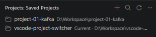
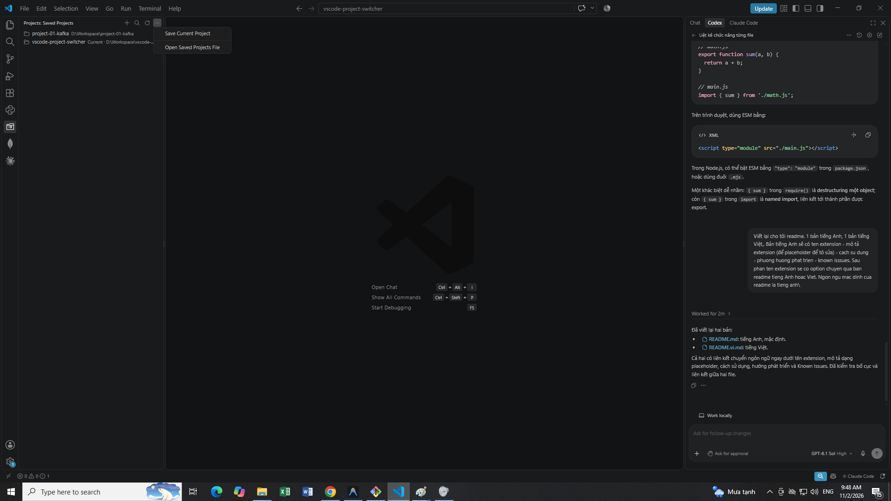
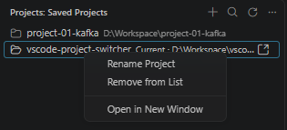

# Project Switcher

**English** | [Tiếng Việt](README.vi.md)

## Description

Working across multiple projects often means finding and reopening folders whenever you launch your IDE. Project Switcher gives you a dedicated sidebar to organize your projects and switch between them. Add each folder once, then open it from your saved list whenever you need it.

Compatible with **VS Code desktop** and **Antigravity IDE**.

## Usage

### Extension overview

Open **Projects** in the Activity Bar to view your saved projects.

Use the toolbar and the **…** menu to add folders and access project options.

Click a project to open it in the current IDE window. To open it in a new window, right-click the project and choose **Open in New Window**.

### Installation

**[Download Project Switcher 0.1.1 (.vsix)](https://github.com/thanhklt/vscode-project-switcher/raw/refs/heads/main/dist/project-switcher-0.1.1.vsix)**

1. Click the download link above to save `project-switcher-0.1.1.vsix` to your computer. You can also browse the available packages in the [`dist/` folder](https://github.com/thanhklt/vscode-project-switcher/tree/main/dist).
2. In VS Code desktop or Antigravity IDE, open **Extensions** → **…** → **Install from VSIX…** and select the file.
3. Reload the editor if prompted, then select **Projects** in the Activity Bar.

Install the extension in each IDE where you want to use it.

To build the VSIX from source, run `npm ci --ignore-scripts` followed by `npm run package`. The packaged file is saved in `dist/`.

### Manage projects

| Action | How to use it |
| --- | --- |
| Add folders | Click **+ / Add Folders** and select one or more local folders. |
| Save the current project | Open the Projects **…** menu and choose **Save Current Project**. Each folder in a multi-folder workspace is saved separately. |
| Open a project | Click a saved project to open it as the workspace in the current editor window. |
| Open in a new window | Right-click a project and choose **Open in New Window**, or click its inline icon. The new window uses the same IDE. |
| Search | Click the search icon or run **Projects: Search Projects** from the Command Palette. Search by name or path. |
| Rename | Right-click a project and choose **Rename Project** to change its display name. |
| Remove | Right-click a project and choose **Remove from List**. The folder and its files remain on disk. |
| Refresh | Click the refresh icon to reload the saved list. |

### Settings and shared storage

| Setting | Default | Purpose |
| --- | --- | --- |
| `projectSwitcher.openInNewWindow` | `false` | Set to `true` to open projects in a new window by default. |
| `projectSwitcher.storagePath` | Empty | Set an absolute path to a custom local projects JSON file. Reload the editor after changing it. |

The default list is stored at `~/.project-switcher/projects.json` (`C:\Users\<user>\.project-switcher\projects.json` on Windows). VS Code and Antigravity IDE running under the same OS account share this file and automatically refresh when it changes.

For a custom location, set the same `projectSwitcher.storagePath` in both IDEs. After saving your first project, run **Projects: Open Saved Projects File** to view or back up the list.

## Roadmap

Ideas for future development; these features are not implemented yet:

- [ ] Import and export `.code-workspace` files.
- [ ] Share a project collection with collaborators.
- [ ] Define a common protocol for AI agents to read context across multiple projects.

## Known Issues

No known issues are currently listed.

## License

This project is licensed under the [MIT License](LICENSE).
